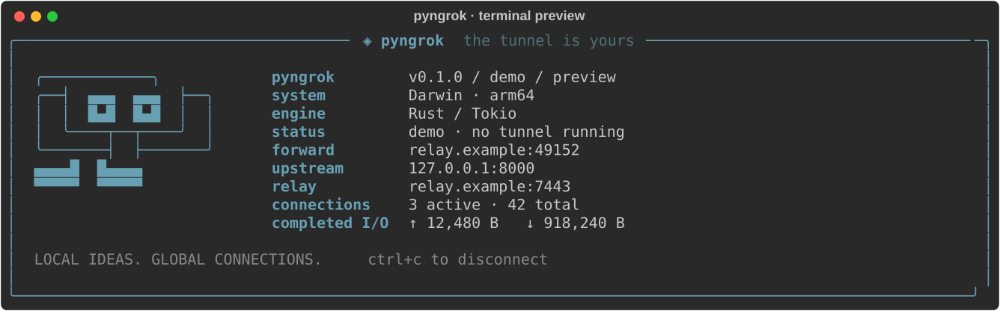

# ◈ pyngrok

A typed Python CLI with a Rust / Tokio reverse-tunnel engine and a neofetch-inspired terminal dashboard.

**Development status:** Python checks, Rust compilation, eight Rust unit tests, rustfmt and Clippy pass locally. Native network integration is blocked by this sandbox's socket permissions and must pass in CI before a standalone release is published. This is an initial implementation, not a verified production tunnel or a complete reconstruction of ngrok. See [the investigation](docs/research/ngrok.md).



## Install on macOS

**Prebuilt installation is pending the first successful standalone release.** The
current published `--HEAD` formula builds from source and downloads Rust, LLVM,
uv and Python. That is why the initial installation is large and slow.

The standalone packages include the Python runtime, CLI libraries and native
engine. Their generated Homebrew formula has **no Homebrew package dependencies**.
The optimized Rust engine is approximately **2.5 MiB**; the complete package size
will be recorded by the release build. Startup time remains unmeasured.

After the [standalone release workflow](.github/workflows/release.yml) succeeds
and updates the formula, install the prebuilt version without `--HEAD`:

```sh
brew tap aryanraj2713/pyngrok https://github.com/aryanraj2713/pyngrok.git
brew update
brew install aryanraj2713/pyngrok/pyngrok
pyngrok preview
pyngrok doctor
```

The [standalone release workflow](.github/workflows/release.yml) builds the Rust
engine and bundles Python and the CLI on GitHub's macOS runners. Only after both
architectures pass checks does it publish a prerelease and replace the default
Homebrew formula with a prebuilt package that has **no Homebrew dependencies**.
The existing default formula remains a source build until that release succeeds.
See the [Homebrew guide](packaging/homebrew/README.md) for installation and status.

## Build from source

For development, install Python 3.11+, uv, and a stable Rust toolchain. From this checkout:

```sh
uv sync
cargo build --release --locked --manifest-path crates/pyngrok-core/Cargo.toml
uv run pyngrok preview
uv run pyngrok doctor
```

The development Homebrew formula is available separately as
`brew install --HEAD aryanraj2713/pyngrok/pyngrok-source`. It compiles locally and
retains the larger build dependencies. Use one Homebrew variant at a time.

## Run a tunnel

Open three terminals with the **same** `PYNGROK_TOKEN` on relay and agent. Generate one with `uv run pyngrok keygen`, then export its output on each machine. Avoid putting secrets in command arguments or shell history.

```sh
# Terminal 1: relay, loopback-only by default
uv run pyngrok relay

# Terminal 2: your local application
python3 -m http.server 8000 --bind 127.0.0.1

# Terminal 3: expose the application through the relay
uv run pyngrok http 8000
# Also: uv run pyngrok tcp 22
```

Visit `http://<public_address>` from the `tunnel_ready` event/dashboard. Local defaults demonstrate forwarding on your own machine. To reach the internet, run the relay on a reachable server and configure its public host, interfaces, firewall, and TLS:

```sh
# Relay server; certificate must match relay.example.com
uv run pyngrok relay --bind 0.0.0.0:7443 \
  --public-bind 0.0.0.0 --public-host relay.example.com \
  --tls-cert server.pem --tls-key server-key.pem

# Developer machine, behind NAT
uv run pyngrok http 8000 --relay relay.example.com:7443 \
  --tls-server-name relay.example.com --public-port 18080
```

`--ca-cert` supports a private CA on the agent. TLS here protects **agent-to-relay traffic**. The dedicated public listener is raw TCP; the `http` command does not create an HTTPS URL or manage certificates. Serve TLS in the upstream application if required. Public ports expose your upstream service to callers; the shared token authenticates agents, not public visitors.

## Interface

- `http PORT` and `tcp HOST:PORT`: transparent byte forwarding, including WebSocket traffic.
- `relay`: run your relay with bounded connections and session-scoped tunnel listeners.
- `preview`: show labeled demo data without opening a tunnel.
- `keygen`, `doctor`, `version`: setup helpers.
- `--json`: newline JSON for scripts. Redirected output also avoids terminal animations.
- Ctrl+C: terminate the supervised engine and close the tunnel.

Use `--help` on any command. Tokens come from `PYNGROK_TOKEN`; `PYNGROK_CORE` overrides the native binary path. Installed Python packages discover the engine on PATH; source checkouts also find local Cargo builds. No Python forwarding fallback silently replaces Rust.

The requested command/import is `pyngrok`. The distribution is provisionally named `pyngrok-cli` because an unrelated [pyngrok package already exists](https://pypi.org/project/pyngrok/); do not install both into one environment. Distribution-name availability has not been checked for publication. This project does not use ngrok accounts or connect to ngrok infrastructure.

## Architecture and limitations

Python validates input, supervises the Rust process, and renders events. Rust owns listeners, TLS, authentication, tickets, connection tasks, backpressure, and bidirectional copying. Each public connection uses its own data channel, avoiding a Python copy loop and shared-stream head-of-line blocking. This incurs a data-connection/TLS handshake per client; throughput and latency need measurement before performance claims.

Read the [wire protocol](docs/protocol.md) for authentication and lifecycle details. There is no managed edge network, wildcard-domain HTTP routing, request inspector/replay, OAuth gateway, account system, automatic reconnect, or ngrok wire compatibility. A dropped session must be restarted. One agent process creates one endpoint.

## Checks

```sh
uv run ruff check .
uv run ruff format --check .
uv run ty check src
uv run pytest
cargo fmt --manifest-path crates/pyngrok-core/Cargo.toml --check
cargo clippy --manifest-path crates/pyngrok-core/Cargo.toml --all-targets -- -D warnings
cargo test --manifest-path crates/pyngrok-core/Cargo.toml
```

Locally, 31 Python unit/packaging tests and eight Rust unit tests pass. The three
native network tests are blocked by sandbox socket permissions and are not
counted as passed. They run against the actual compiled engine in release CI.
The integration tests skip with an explicit reason when the native binary is
absent. Python subprocess tests establish CLI supervision, not Rust forwarding
correctness. See the [validation record](docs/validation.md) for the full scope.
